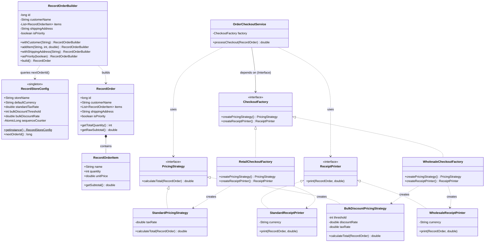

# Creational Design Patterns Verification Report

## Executive Summary

This project implements a complete order-processing and checkout architecture for a **Music Record Store** (**Vintage Groove Records**) by implementing **3 Creational Design Patterns** in Java (JDK 11+):

- **Patterns implemented**:
  1. **Singleton Pattern** ([`RecordStoreConfig`](file:///home/calin/code/tmps-labs/lab-1/src/com/tmps/lab1/RecordStoreConfig.java#L11))
  2. **Builder Pattern** ([`RecordOrderBuilder`](file:///home/calin/code/tmps-labs/lab-1/src/com/tmps/lab1/RecordOrderBuilder.java#L11))
  3. **Abstract Factory Pattern** ([`CheckoutFactory`](file:///home/calin/code/tmps-labs/lab-1/src/com/tmps/lab1/CheckoutFactory.java#L8))

---

## Architecture Overview



---

## Detailed Pattern Breakdown

### 1. Singleton Pattern
> *Ensure a class has only one instance, and provide a global point of access to it.*

#### Status: PASS

#### Motivation & Role in Domain
In a music record store enterprise ("Vintage Groove Records"), global financial and operational rules must remain coherent across all sales channels. Parameters including store identity (`storeName`), trading currency (`defaultCurrency`), standard sales tax/VAT rates (`standardTaxRate`), bulk vinyl crate discount thresholds (`bulkDiscountThreshold`), and discount percentages (`bulkDiscountRate`) require a single authoritative source of truth.

Furthermore, multi-channel checkouts (e.g., in-store vinyl counters and bulk wholesale orders) require synchronized, unique invoice sequence numbers. Maintaining disparate configuration instances would result in divergent tax rates, unsynchronized invoice references, and financial reporting inconsistencies.

#### Analysis & Implementation Details
The singleton is implemented in [`RecordStoreConfig`](file:///home/calin/code/tmps-labs/lab-1/src/com/tmps/lab1/RecordStoreConfig.java#L11) using Java's idiomatic **Initialization-on-demand Holder idiom** (Bill Pugh Singleton):
- **Thread Safety & Lock-Free Performance**: The nested static helper class `InstanceHolder` is not loaded into memory until the static `getInstance()` method is invoked. The JVM guarantees thread-safe, race-condition-free initialization through internal class-loading mechanics without the performance penalty of `synchronized` method blocks.
- **Enforced Encapsulation**: A `private RecordStoreConfig()` constructor prevents accidental instantiation from outside the class or foreign packages.
- **Atomic Sequence Generation**: Sequential order generation leverages [`AtomicLong`](file:///home/calin/code/tmps-labs/lab-1/src/com/tmps/lab1/RecordStoreConfig.java#L20) (`sequenceCounter.incrementAndGet()`), providing thread-safe, lockless incremental identifier generation for concurrent order creation.

#### Code Reference
```java
// src/com/tmps/lab1/RecordStoreConfig.java
package com.tmps.lab1;

import java.util.concurrent.atomic.AtomicLong;

public class RecordStoreConfig {

    private String storeName = "Vintage Groove Records";
    private String defaultCurrency = "USD";
    private double standardTaxRate = 0.20; // 20% VAT / Sales Tax
    private int bulkDiscountThreshold = 10; // 10 or more vinyl records for bulk discount
    private double bulkDiscountRate = 0.15; // 15% discount for bulk crates/orders

    private final AtomicLong sequenceCounter = new AtomicLong(1000L);

    // Private constructor prevents external instantiation
    private RecordStoreConfig() {}

    private static class InstanceHolder {
        private static final RecordStoreConfig INSTANCE = new RecordStoreConfig();
    }

    public static RecordStoreConfig getInstance() {
        return InstanceHolder.INSTANCE;
    }

    public String getStoreName() { return storeName; }
    public void setStoreName(String storeName) { this.storeName = storeName; }

    public String getDefaultCurrency() { return defaultCurrency; }
    public void setDefaultCurrency(String defaultCurrency) { this.defaultCurrency = defaultCurrency; }

    public double getStandardTaxRate() { return standardTaxRate; }
    public void setStandardTaxRate(double standardTaxRate) { this.standardTaxRate = standardTaxRate; }

    public int getBulkDiscountThreshold() { return bulkDiscountThreshold; }
    public void setBulkDiscountThreshold(int bulkDiscountThreshold) { this.bulkDiscountThreshold = bulkDiscountThreshold; }

    public double getBulkDiscountRate() { return bulkDiscountRate; }
    public void setBulkDiscountRate(double bulkDiscountRate) { this.bulkDiscountRate = bulkDiscountRate; }

    public long nextOrderId() {
        return sequenceCounter.incrementAndGet();
    }
}
```

---

### 2. Builder Pattern
> *Separate the construction of a complex object from its representation so that the same construction process can create different representations.*

#### Status: PASS

#### Motivation & Role in Domain
In a music record store, incoming orders range from a single collector purchasing a rare vinyl reissue for in-store pickup to large commercial vinyl cafes ordering crates of records with priority delivery and itemized destination addresses. A [`RecordOrder`](file:///home/calin/code/tmps-labs/lab-1/src/com/tmps/lab1/RecordOrder.java#L10) is a complex aggregate composed of:
- Sequential identifier (`id`)
- Customer identity (`customerName`)
- List of line items (`items: List<RecordOrderItem>`)
- Optional physical delivery destination (`shippingAddress`)
- Priority courier fulfillment flag (`isPriority`)

Direct constructor instantiation with multiple optional parameters leads to constructor telescoping, error-prone parameter ordering (e.g., swapping strings or booleans), and scattered validation logic. [`RecordOrderBuilder`](file:///home/calin/code/tmps-labs/lab-1/src/com/tmps/lab1/RecordOrderBuilder.java#L11) solves this by providing fluent, step-by-step assembly and enforcing strict domain invariants before constructing an immutable [`RecordOrder`](file:///home/calin/code/tmps-labs/lab-1/src/com/tmps/lab1/RecordOrder.java#L10).

#### Analysis & Implementation Details
- **Fluent Method Chaining**: Every mutator returns `this` (`RecordOrderBuilder`), permitting expressive, chained method calls.
- **Precondition & Invariant Enforcement**:
  - Item quantities must be strictly positive (`quantity > 0`).
  - Unit prices must be non-negative (`unitPrice >= 0.0`).
  - `customerName` cannot be null or blank upon invoking `build()`.
  - An order must contain at least one valid [`RecordOrderItem`](file:///home/calin/code/tmps-labs/lab-1/src/com/tmps/lab1/RecordOrderItem.java#L8).
- **Immutability Guarantee**: [`RecordOrder`](file:///home/calin/code/tmps-labs/lab-1/src/com/tmps/lab1/RecordOrder.java#L10) has no setters and wraps items in `Collections.unmodifiableList(new ArrayList<>(items))`, preventing external mutation of line items post-construction.

#### Code Reference
```java
// src/com/tmps/lab1/RecordOrderBuilder.java
package com.tmps.lab1;

import java.util.ArrayList;
import java.util.Collections;
import java.util.List;

public class RecordOrderBuilder {
    private long id = RecordStoreConfig.getInstance().nextOrderId();
    private String customerName = "";
    private final List<RecordOrderItem> items = new ArrayList<>();
    private String shippingAddress = null;
    private boolean isPriority = false;

    public RecordOrderBuilder withCustomer(String name) {
        this.customerName = name != null ? name.trim() : "";
        return this;
    }

    public RecordOrderBuilder addItem(String name, int quantity, double unitPrice) {
        if (quantity <= 0) {
            throw new IllegalArgumentException("Item quantity must be greater than zero: " + quantity);
        }
        if (unitPrice < 0.0) {
            throw new IllegalArgumentException("Item unit price cannot be negative: " + unitPrice);
        }
        this.items.add(new RecordOrderItem(name, quantity, unitPrice));
        return this;
    }

    public RecordOrderBuilder withShippingAddress(String address) {
        this.shippingAddress = (address != null && !address.trim().isEmpty()) ? address.trim() : null;
        return this;
    }

    public RecordOrderBuilder asPriority(boolean priority) {
        this.isPriority = priority;
        return this;
    }

    public RecordOrder build() {
        if (customerName == null || customerName.trim().isEmpty()) {
            throw new IllegalStateException("Customer name is required to build a RecordOrder");
        }
        if (items.isEmpty()) {
            throw new IllegalStateException("RecordOrder must contain at least one RecordOrderItem");
        }

        return new RecordOrder(
                id,
                customerName,
                Collections.unmodifiableList(new ArrayList<>(items)),
                shippingAddress,
                isPriority
        );
    }
}
```

---

### 3. Abstract Factory Pattern
> *Provide an interface for creating families of related or dependent objects without specifying their concrete classes.*

#### Status: PASS

#### Motivation & Role in Domain
The checkout engine coordinates two collaborative abstractions:
1. [`PricingStrategy`](file:///home/calin/code/tmps-labs/lab-1/src/com/tmps/lab1/PricingStrategy.java#L7): Computes financial figures (subtotals, volume discounts, taxes).
2. [`ReceiptPrinter`](file:///home/calin/code/tmps-labs/lab-1/src/com/tmps/lab1/ReceiptPrinter.java#L7): Formats customer-facing or accounting documentation.

A record store operates across two primary business models:
- **Standard Retail**: Individual collectors and audiophiles require [`StandardPricingStrategy`](file:///home/calin/code/tmps-labs/lab-1/src/com/tmps/lab1/StandardPricingStrategy.java#L6) (gross subtotal + standard sales tax/VAT) paired with [`StandardReceiptPrinter`](file:///home/calin/code/tmps-labs/lab-1/src/com/tmps/lab1/StandardReceiptPrinter.java#L8) (concise POS sales receipt).
- **Wholesale B2B**: Indie record shops, vinyl cafes, and radio stations buying bulk crates require [`BulkDiscountPricingStrategy`](file:///home/calin/code/tmps-labs/lab-1/src/com/tmps/lab1/BulkDiscountPricingStrategy.java#L7) (volume discount applied to bulk quantities) paired with [`WholesaleReceiptPrinter`](file:///home/calin/code/tmps-labs/lab-1/src/com/tmps/lab1/WholesaleReceiptPrinter.java#L9) (commercial B2B tax invoice itemizing crate units, gross subtotal, volume discount deduction, VAT, and designated shipping address).

Mismatched pairings—such as applying wholesale discount pricing while printing a consumer receipt with missing invoice details—creates accounting non-compliance. The [`CheckoutFactory`](file:///home/calin/code/tmps-labs/lab-1/src/com/tmps/lab1/CheckoutFactory.java#L8) interface guarantees that mutually compatible families of pricing and printing components are instantiated together.

#### Analysis & Implementation Details
- **Abstract Factory Contract**: [`CheckoutFactory`](file:///home/calin/code/tmps-labs/lab-1/src/com/tmps/lab1/CheckoutFactory.java#L8) declares:
  - `PricingStrategy createPricingStrategy()`
  - `ReceiptPrinter createReceiptPrinter()`
- **Concrete Factory Implementations**:
  - [`RetailCheckoutFactory`](file:///home/calin/code/tmps-labs/lab-1/src/com/tmps/lab1/RetailCheckoutFactory.java#L6): Creates `StandardPricingStrategy` and `StandardReceiptPrinter`.
  - [`WholesaleCheckoutFactory`](file:///home/calin/code/tmps-labs/lab-1/src/com/tmps/lab1/WholesaleCheckoutFactory.java#L6): Creates `BulkDiscountPricingStrategy` and `WholesaleReceiptPrinter`.
- **Client Decoupling**: [`OrderCheckoutService`](file:///home/calin/code/tmps-labs/lab-1/src/com/tmps/lab1/OrderCheckoutService.java#L8) depends exclusively on the `CheckoutFactory` abstraction, remaining completely oblivious to concrete strategy and printer implementations (conforming to the Dependency Inversion Principle).

#### Code Reference
```java
// src/com/tmps/lab1/CheckoutFactory.java
package com.tmps.lab1;

public interface CheckoutFactory {
    PricingStrategy createPricingStrategy();
    ReceiptPrinter createReceiptPrinter();
}

// src/com/tmps/lab1/RetailCheckoutFactory.java
package com.tmps.lab1;

public class RetailCheckoutFactory implements CheckoutFactory {
    @Override
    public PricingStrategy createPricingStrategy() {
        return new StandardPricingStrategy();
    }

    @Override
    public ReceiptPrinter createReceiptPrinter() {
        return new StandardReceiptPrinter();
    }
}

// src/com/tmps/lab1/WholesaleCheckoutFactory.java
package com.tmps.lab1;

public class WholesaleCheckoutFactory implements CheckoutFactory {
    @Override
    public PricingStrategy createPricingStrategy() {
        return new BulkDiscountPricingStrategy();
    }

    @Override
    public ReceiptPrinter createReceiptPrinter() {
        return new WholesaleReceiptPrinter();
    }
}

// src/com/tmps/lab1/OrderCheckoutService.java
package com.tmps.lab1;

public class OrderCheckoutService {
    private final CheckoutFactory factory;

    public OrderCheckoutService(CheckoutFactory factory) {
        if (factory == null) {
            throw new IllegalArgumentException("CheckoutFactory cannot be null");
        }
        this.factory = factory;
    }

    public double processCheckout(RecordOrder order) {
        PricingStrategy pricingStrategy = factory.createPricingStrategy();
        ReceiptPrinter printer = factory.createReceiptPrinter();

        double total = pricingStrategy.calculateTotal(order);
        printer.print(order, total);
        return total;
    }
}
```

---

## Execution & Verification

Running [`Main.java`](file:///home/calin/code/tmps-labs/lab-1/src/com/tmps/lab1/Main.java#L6) demonstrates all 3 patterns interacting seamlessly with interactive console input:

### Retail Execution Sample (Standard Channel)
```
TMPS Lab 1: Creational Design Patterns Demonstration (Music Record Store)

[1] Singleton Pattern: RecordStoreConfig
Store Name: Vintage Groove Records
Active Currency: USD
Default VAT Rate: 20.0%
Next Order ID generated: 1001

[2] Builder Pattern: Constructing RecordOrder
Enter customer name (press Enter for default 'Miles Davis'): Miles Davis
Is this a priority order? (y/N): n
Shipping destination (press Enter for 'Self-pickup'): 
Enter record order items (press Enter on item name to finish):
  Item 1 name: Pink Floyd - The Dark Side of the Moon (Vinyl LP)
  Quantity (default 1): 1
  Unit price (default 30.0): 35.0
  Item 2 name: Miles Davis - Kind of Blue (Vinyl LP)
  Quantity (default 1): 2
  Unit price (default 30.0): 30.0
  Item 3 name: 

Order #1002 constructed successfully for Miles Davis.

[3] Abstract Factory Pattern: Checkout Processing
Select checkout channel [1: Retail, 2: Wholesale B2B] (default 1): 1
RETAIL RECEIPT
Store: Vintage Groove Records
Order ID: #1002 | Customer: Miles Davis
Priority: NO
Items:
  Pink Floyd - The Dark Side of the Moon (Vinyl LP) x1 @ 35.00 USD = 35.00 USD
  Miles Davis - Kind of Blue (Vinyl LP) x2 @ 30.00 USD = 60.00 USD
Total (incl. tax): 114.00 USD

Execution completed. Total charged: 114.00 USD
```

### Wholesale B2B Execution Sample (Bulk Discount Channel)
```
TMPS Lab 1: Creational Design Patterns Demonstration (Music Record Store)

[1] Singleton Pattern: RecordStoreConfig
Store Name: Vintage Groove Records
Active Currency: USD
Default VAT Rate: 20.0%
Next Order ID generated: 1001

[2] Builder Pattern: Constructing RecordOrder
Enter customer name (press Enter for default 'Miles Davis'): Blue Note Records Club
Is this a priority order? (y/N): y
Shipping destination (press Enter for 'Self-pickup'): 45 Jazz Blvd, New Orleans, LA
Enter record order items (press Enter on item name to finish):
  Item 1 name: Miles Davis - Kind of Blue (Vinyl LP)
  Quantity (default 1): 10
  Unit price (default 30.0): 30.0
  Item 2 name: John Coltrane - A Love Supreme (Vinyl LP)
  Quantity (default 1): 5
  Unit price (default 30.0): 32.0
  Item 3 name: 

Order #1002 constructed successfully for Blue Note Records Club.

[3] Abstract Factory Pattern: Checkout Processing
Select checkout channel [1: Retail, 2: Wholesale B2B] (default 1): 2
COMMERCIAL INVOICE (B2B)
Issuer: Vintage Groove Records
Invoice Ref: INV-1002
Client: Blue Note Records Club
Shipping Destination: 45 Jazz Blvd, New Orleans, LA
Total Vinyl Units: 15
Line Items:
  [VINYL] Miles Davis - Kind of Blue (Vinyl LP)    Qty: 10   Unit: 30.00 USD
  [VINYL] John Coltrane - A Love Supreme (Vinyl LP) Qty: 5    Unit: 32.00 USD
Accounting Summary:
  Gross Subtotal:     460.00 USD
  Bulk Discount (15%): -69.00 USD
  Tax (VAT 20%):       +78.20 USD
  Final Invoice Due:  469.20 USD

Execution completed. Total charged: 469.20 USD
```

---

## Pattern Summary Matrix

| Pattern | Implementing Types | Role & Domain Value | GoF Classification |
| :--- | :--- | :--- | :--- |
| **Singleton** | [`RecordStoreConfig`](file:///home/calin/code/tmps-labs/lab-1/src/com/tmps/lab1/RecordStoreConfig.java#L11) | Single global source of truth for store policies, tax rates, bulk volume thresholds, and thread-safe atomic order sequence numbers via Bill Pugh idiom. | Creational (Object) |
| **Builder** | [`RecordOrderBuilder`](file:///home/calin/code/tmps-labs/lab-1/src/com/tmps/lab1/RecordOrderBuilder.java#L11), [`RecordOrder`](file:///home/calin/code/tmps-labs/lab-1/src/com/tmps/lab1/RecordOrder.java#L10) | Step-by-step construction of complex record orders with invariant enforcement and defensive immutability. | Creational (Object) |
| **Abstract Factory** | [`CheckoutFactory`](file:///home/calin/code/tmps-labs/lab-1/src/com/tmps/lab1/CheckoutFactory.java#L8), [`RetailCheckoutFactory`](file:///home/calin/code/tmps-labs/lab-1/src/com/tmps/lab1/RetailCheckoutFactory.java#L6), [`WholesaleCheckoutFactory`](file:///home/calin/code/tmps-labs/lab-1/src/com/tmps/lab1/WholesaleCheckoutFactory.java#L6) | Creates coordinated families of pricing strategies and receipt formatters tailored to Retail vs Wholesale B2B vinyl channels. | Creational (Object) |
