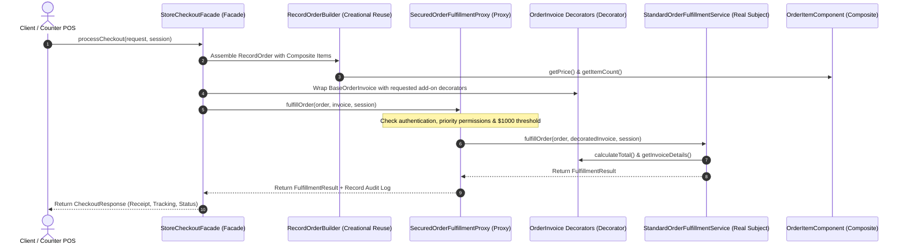
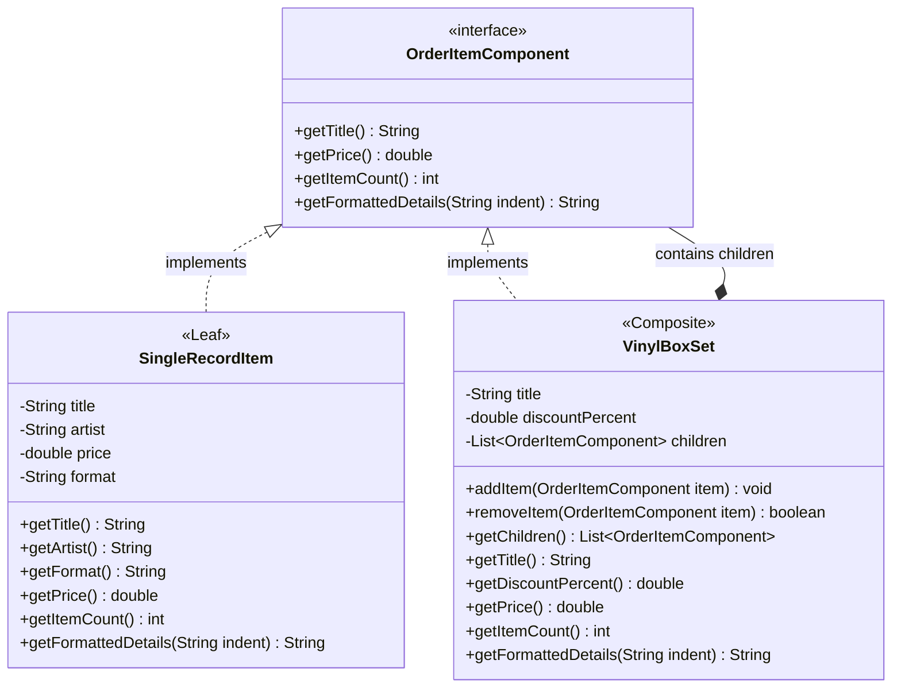
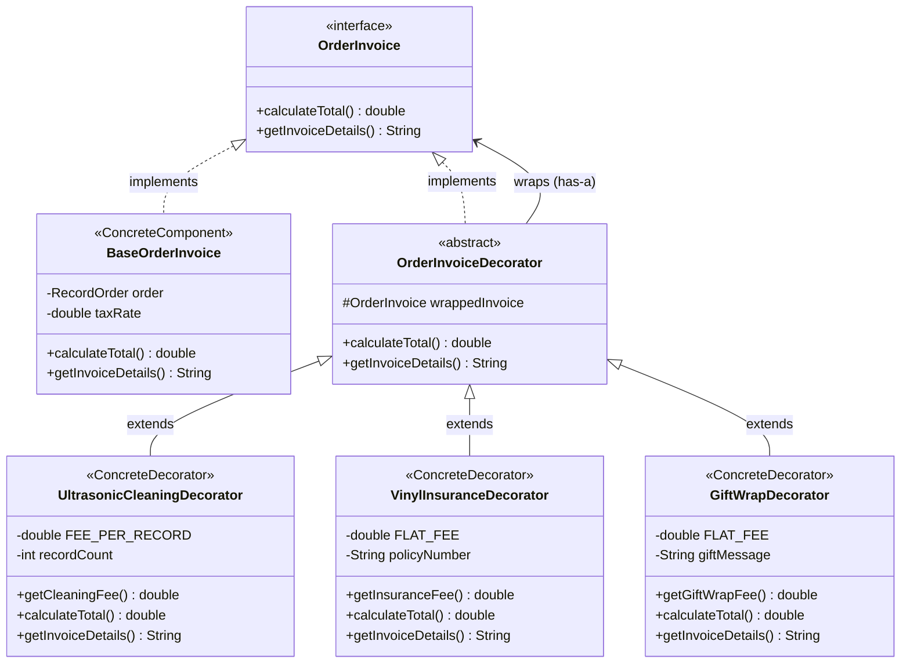
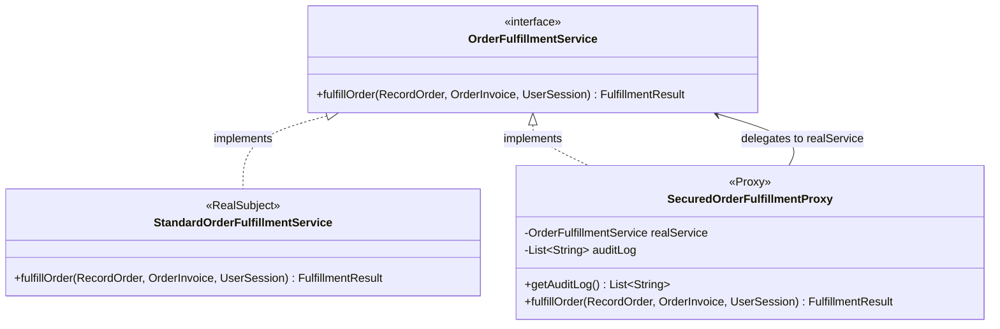
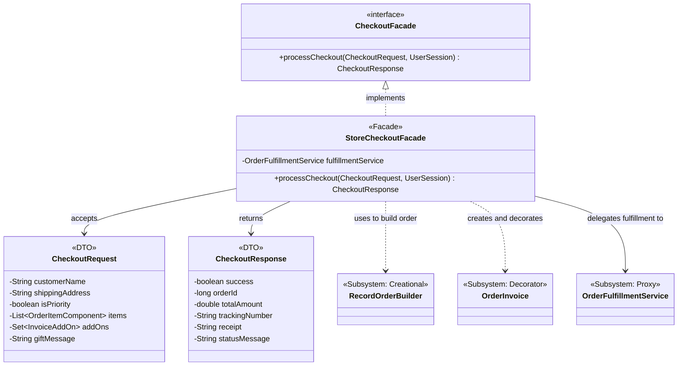

# Structural Design Patterns Verification Report

**Course**: Tehnici și Mecanisme de Proiectare Software (TMPS) / Software Design Techniques and Mechanisms  
**Laboratory Work**: No. 2 — Structural Design Patterns  
**Domain**: Vintage Groove Records (Specialty Music Vinyl Store & Fulfillment System)  
**Implementation Language**: Java (OpenJDK 11+)  

---

## 1. Domain Description

**Vintage Groove Records** is an e-commerce and retail fulfillment platform catering to audiophile vinyl collectors and music enthusiasts. The application manages an inventory catalog consisting of both individual vinyl pressings (standard 12" LPs, 7" singles) and curated multi-disc collector box sets.

During the purchase process, the system allows collectors to dynamically configure custom post-sale services—such as ultrasonic deep record cleaning, transit loss and breakage insurance, and Japanese Obi gift packaging. Furthermore, transactional fulfillment is guarded by role-based access control and strict order-value threshold validation, accompanied by an immutable security audit trail. A unified checkout facade orchestrates the assembly, pricing, decoration, authorization, and dispatch pipeline without exposing subsystem complexity to the client interface.

---

## 2. Architectural Pattern Interactions Overview

The mandatory requirement states that patterns must not exist as isolated demos; at least one execution path must traverse multiple structural patterns. In this project, the patterns interact seamlessly during the checkout process:



**Execution Path Flow**:
1. **Client** invokes [`StoreCheckoutFacade.processCheckout(...)`](file:///home/calin/code/tmps-labs/lab-2/src/com/tmps/lab2/facade/StoreCheckoutFacade.java#L30-L72).
2. The **Facade** coordinates the creational [`RecordOrderBuilder`](file:///home/calin/code/tmps-labs/lab-2/src/com/tmps/lab2/domain/RecordOrderBuilder.java#L11-L67) to assemble the order containing **Composite** items ([`OrderItemComponent`](file:///home/calin/code/tmps-labs/lab-2/src/com/tmps/lab2/composite/OrderItemComponent.java#L3-L8): single records and multi-album box sets).
3. The **Facade** instantiates [`BaseOrderInvoice`](file:///home/calin/code/tmps-labs/lab-2/src/com/tmps/lab2/decorator/BaseOrderInvoice.java#L8-L58) and dynamically wraps it with selected **Decorator** instances ([`UltrasonicCleaningDecorator`](file:///home/calin/code/tmps-labs/lab-2/src/com/tmps/lab2/decorator/UltrasonicCleaningDecorator.java#L5-L36), [`VinylInsuranceDecorator`](file:///home/calin/code/tmps-labs/lab-2/src/com/tmps/lab2/decorator/VinylInsuranceDecorator.java#L5-L48), [`GiftWrapDecorator`](file:///home/calin/code/tmps-labs/lab-2/src/com/tmps/lab2/decorator/GiftWrapDecorator.java#L5-L48)).
4. The **Facade** passes the order, decorated invoice, and caller's [`UserSession`](file:///home/calin/code/tmps-labs/lab-2/src/com/tmps/lab2/domain/UserSession.java#L3-L41) to the **Proxy** ([`SecuredOrderFulfillmentProxy`](file:///home/calin/code/tmps-labs/lab-2/src/com/tmps/lab2/proxy/SecuredOrderFulfillmentProxy.java#L15-L75)).
5. The **Proxy** validates credentials, enforces security invariants (e.g. guest restrictions on priority courier dispatches and transactions exceeding $1,000), logs the audit attempt, and delegates execution to the **Real Subject** ([`StandardOrderFulfillmentService`](file:///home/calin/code/tmps-labs/lab-2/src/com/tmps/lab2/proxy/StandardOrderFulfillmentService.java#L10-L48)).
6. The **Real Subject** computes the final itemized receipt and tracking number, returning a unified [`CheckoutResponse`](file:///home/calin/code/tmps-labs/lab-2/src/com/tmps/lab2/facade/CheckoutResponse.java#L3-L46) to the client.

---

## 3. Reused Creational Pattern (from Laboratory 1)

In compliance with **Requirement 5**, this project reuses the **Builder Pattern** from Laboratory 1:
- **Class**: [`RecordOrderBuilder`](file:///home/calin/code/tmps-labs/lab-2/src/com/tmps/lab2/domain/RecordOrderBuilder.java#L11-L67)
- **Role**: Fluidly constructs immutable [`RecordOrder`](file:///home/calin/code/tmps-labs/lab-2/src/com/tmps/lab2/domain/RecordOrder.java#L9-L55) instances. It encapsulates atomic transaction ID generation, customer assignment, delivery destination specification, priority shipment tagging, and collection of polymorphic items ([`OrderItemComponent`](file:///home/calin/code/tmps-labs/lab-2/src/com/tmps/lab2/composite/OrderItemComponent.java#L3-L8)).
- **Invariant Validation**: Enforces non-blank customer identity and non-empty item lists before yielding the built object.

---

## 4. Structural Design Patterns Breakdown

Rather than combining everything into an enormous, unreadable UML diagram, each structural design pattern is documented in its own dedicated subsection with a focused class diagram, code snippet, and unit test verification.

---

### 4.1. Pattern 1: Composite Pattern

#### Intent & Problem Solved
In a vinyl record store, the catalog consists of both individual vinyl pressings (e.g., a single 12" LP) and multi-record box sets (e.g., an artist discography or retrospective collection). Furthermore, box sets can contain nested sub-bundles or bonus 7" singles. 

Without the **Composite Pattern**, client code (and the order-building subsystem) would need distinct classes with differing APIs, forcing the use of type-checks (`instanceof VinylBoxSet`) and nested loops to compute totals or print catalog listings. The **Composite Pattern** allows individual items and groups of items to be treated uniformly through the common [`OrderItemComponent`](file:///home/calin/code/tmps-labs/lab-2/src/com/tmps/lab2/composite/OrderItemComponent.java#L3-L8) interface.

#### Dedicated UML Class Diagram



#### Code Snippet
From [`VinylBoxSet.java`](file:///home/calin/code/tmps-labs/lab-2/src/com/tmps/lab2/composite/VinylBoxSet.java#L48-L65):

```java
    @Override
    public double getPrice() {
        double subtotal = 0.0;
        for (OrderItemComponent item : children) {
            subtotal += item.getPrice();
        }
        return subtotal * (1.0 - (discountPercent / 100.0));
    }

    @Override
    public int getItemCount() {
        int count = 0;
        for (OrderItemComponent item : children) {
            count += item.getItemCount();
        }
        return count;
    }
```
*Why this makes the pattern work*: The composite `VinylBoxSet` aggregates child `OrderItemComponent` instances and computes recursive price subtotals and vinyl disc counts by delegating uniformly to each child's interface method without checking whether a child is a leaf or another composite box set.

#### Unit Test Verification

| Test Method Name | Key Property Checked | Status |
| :--- | :--- | :---: |
| `testLeafAndCompositeCanBeUsedUniformlyThroughSameInterface()` | Proves that `SingleRecordItem` (leaf) and `VinylBoxSet` (composite) are consumed polymorphically through a single `List<OrderItemComponent>` without `instanceof` checks, yielding accurate total values and item counts. | **PASS** |
| `testNestedBoxSetCalculatesDiscountAndItemCountRecursively()` | Proves that deeply nested box sets (e.g. Master Anthology containing an inner 3-LP box set and bonus single) recursively compute accurate disc counts and compound bundle discounts. | **PASS** |

**Execution Log**:
```text
>> Running Test Suite: CompositePatternTest
   [PASS] testLeafAndCompositeCanBeUsedUniformlyThroughSameInterface        (22 ms)
   [PASS] testNestedBoxSetCalculatesDiscountAndItemCountRecursively         (1 ms)
```

---

### 4.2. Pattern 2: Decorator Pattern

#### Intent & Problem Solved
Record purchasers frequently select optional value-added services: ultrasonic deep bath cleaning and anti-static inner sleeving, transit damage/loss insurance, and luxury Japanese Obi gift packaging with personalized cards.

If subclass inheritance were used to model every service combination, the codebase would suffer from class explosion ($2^N = 8$ subclasses for 3 services: `InsuredCleanedOrder`, `GiftCleanedOrder`, etc.). The **Decorator Pattern** allows these responsibilities to be attached dynamically at runtime by wrapping an [`OrderInvoice`](file:///home/calin/code/tmps-labs/lab-2/src/com/tmps/lab2/decorator/OrderInvoice.java#L3-L6) component, in any combination and stacking order.

#### Dedicated UML Class Diagram



#### Code Snippet
From [`UltrasonicCleaningDecorator.java`](file:///home/calin/code/tmps-labs/lab-2/src/com/tmps/lab2/decorator/UltrasonicCleaningDecorator.java#L25-L35):

```java
    @Override
    public double calculateTotal() {
        return super.calculateTotal() + getCleaningFee();
    }

    @Override
    public String getInvoiceDetails() {
        return super.getInvoiceDetails() +
                String.format(Locale.US, " + [Add-On Service] Ultrasonic Deep Cleaning & Archival Sleeves (%d records @ $%.2f): +%8.2f USD%n",
                        recordCount, FEE_PER_RECORD, getCleaningFee());
    }
```
*Why this makes the pattern work*: The decorator overrides the component interface methods, invokes `super` (which delegates to the inner wrapped `OrderInvoice`), and appends its specific add-on fee and itemized service description to the output.

#### Unit Test Verification

| Test Method Name | Key Property Checked | Status |
| :--- | :--- | :---: |
| `testDecoratorsCanBeStackedInAnyOrderWithIdenticalTotal()` | Stacks decorators across multiple arbitrary permutations (`Cleaning -> Insurance -> GiftWrap` vs `GiftWrap -> Insurance -> Cleaning` vs `Insurance -> GiftWrap -> Cleaning`) and verifies that all permutations produce the identical total ($108.50) while preserving all line-item descriptions. | **PASS** |
| `testIndividualDecoratorsAddExpectedSurchargeAndDetails()` | Proves each decorator individually adds its exact mathematical surcharge and injects its dedicated formatted description with parameter values (record counts, policy number, custom gift card). | **PASS** |

**Execution Log**:
```text
>> Running Test Suite: DecoratorPatternTest
   [PASS] testDecoratorsCanBeStackedInAnyOrderWithIdenticalTotal            (30 ms)
   [PASS] testIndividualDecoratorsAddExpectedSurchargeAndDetails            (2 ms)
```

---

### 4.3. Pattern 3: Proxy Pattern

#### Intent & Problem Solved
Fulfillment of vinyl orders involves warehouse dispatch, payment clearance, and assigning courier manifests. Unchecked access allows security vulnerabilities: unauthenticated guests could finalize orders, regular users could hijack expedited priority air couriers, and high-value wholesale transactions could clear without manager approval.

Modifying the fulfillment service directly to incorporate authentication, role authorization, and audit logging violates the Single Responsibility Principle and clutters domain business logic. The **Proxy Pattern** introduces [`SecuredOrderFulfillmentProxy`](file:///home/calin/code/tmps-labs/lab-2/src/com/tmps/lab2/proxy/SecuredOrderFulfillmentProxy.java#L15-L75), which implements the identical [`OrderFulfillmentService`](file:///home/calin/code/tmps-labs/lab-2/src/com/tmps/lab2/proxy/OrderFulfillmentService.java#L7-L9) interface as [`StandardOrderFulfillmentService`](file:///home/calin/code/tmps-labs/lab-2/src/com/tmps/lab2/proxy/StandardOrderFulfillmentService.java#L10-L48), intercepting calls to validate credentials, enforce security policies, maintain an immutable audit trail, and forward only authorized requests.

#### Dedicated UML Class Diagram



#### Code Snippet
From [`SecuredOrderFulfillmentProxy.java`](file:///home/calin/code/tmps-labs/lab-2/src/com/tmps/lab2/proxy/SecuredOrderFulfillmentProxy.java#L42-L73):

```java
        // 1. Guard check: User authentication
        if (session == null || !session.isAuthenticated()) {
            String deniedMsg = String.format("[SECURITY DENIED %s] Anonymous/unauthenticated checkout blocked for Order #%d.",
                    timestamp, order.getId());
            auditLog.add(deniedMsg);
            throw new AccessDeniedException("Authentication required: Guest users cannot finalize transactional orders.");
        }

        // 2. Guard check: Priority dispatch restriction
        if (order.isPriority() && session.getRole() == UserRole.GUEST) {
            String deniedMsg = String.format("[SECURITY DENIED %s] User '%s' lacks privilege for priority courier dispatch on Order #%d.",
                    timestamp, session.getUsername(), order.getId());
            auditLog.add(deniedMsg);
            throw new AccessDeniedException("Access Denied: Priority expedited dispatch requires a verified user account.");
        }

        // 3. Guard check: High-value wholesale order threshold (> $1000 requires STAFF or ADMIN)
        double total = invoice.calculateTotal();
        if (total > 1000.0 && session.getRole() != UserRole.STAFF && session.getRole() != UserRole.ADMIN) {
            String deniedMsg = String.format("[SECURITY DENIED %s] High-value order (%.2f USD) for user '%s' requires STAFF or ADMIN approval.",
                    timestamp, total, session.getUsername());
            auditLog.add(deniedMsg);
            throw new AccessDeniedException(String.format(
                    "Access Denied: High-value transactions (%.2f USD > $1000.00) require STAFF or ADMIN authorization.", total));
        }

        // 4. Authorized: Record security grant and delegate transparently to real service
        String grantedMsg = String.format("[SECURITY GRANTED %s] User '%s' [%s] authorized for Order #%d (Total: %.2f USD).",
                timestamp, session.getUsername(), session.getRole(), order.getId(), total);
        auditLog.add(grantedMsg);

        return realService.fulfillOrder(order, invoice, session);
```
*Why this makes the pattern work*: The proxy preserves the identical subject interface while intercepting invocations before they reach the real fulfillment service. If any security constraint is violated, it intercepts execution, writes to the security audit trail, and raises an `AccessDeniedException` without invoking the real service.

#### Unit Test Verification

| Test Method Name | Key Property Checked | Status |
| :--- | :--- | :---: |
| `testProxyBlocksUnauthorizedAccessAndPassesAuthorized()` | Proves the proxy blocks unauthenticated guest sessions and rejects high-value orders (> $1000) attempted by unprivileged users, while passing authorized customer and staff calls completely unchanged. | **PASS** |
| `testProxyAuditLogRecordsBothDeniedAndGrantedAttempts()` | Proves that all intercepted security decisions (denied access and granted authorizations) are accurately recorded in the proxy's audit log with timestamps and context. | **PASS** |

**Execution Log**:
```text
>> Running Test Suite: ProxyPatternTest
   [PASS] testProxyBlocksUnauthorizedAccessAndPassesAuthorized              (49 ms)
   [PASS] testProxyAuditLogRecordsBothDeniedAndGrantedAttempts              (1 ms)
```

---

### 4.4. Pattern 4: Facade Pattern

#### Intent & Problem Solved
To place an order, client applications would normally need to interact with multiple separate subsystem classes: invoking [`RecordOrderBuilder`](file:///home/calin/code/tmps-labs/lab-2/src/com/tmps/lab2/domain/RecordOrderBuilder.java#L11-L67), managing [`OrderItemComponent`](file:///home/calin/code/tmps-labs/lab-2/src/com/tmps/lab2/composite/OrderItemComponent.java#L3-L8) trees, wrapping base invoices with multiple decorator layers, configuring the proxy, and parsing fulfillment results.

This creates tight coupling between the client and subsystem components. The **Facade Pattern** provides a single, high-level entry point: [`StoreCheckoutFacade`](file:///home/calin/code/tmps-labs/lab-2/src/com/tmps/lab2/facade/StoreCheckoutFacade.java#L15-L73) implementing [`CheckoutFacade`](file:///home/calin/code/tmps-labs/lab-2/src/com/tmps/lab2/facade/CheckoutFacade.java#L5-L7). As emphasized in the laboratory requirements, the Facade does **not** become a god class with business logic; it acts purely as an orchestrator, delegating to the appropriate subsystem classes in the correct sequence.

#### Dedicated UML Class Diagram



#### Code Snippet
From [`StoreCheckoutFacade.java`](file:///home/calin/code/tmps-labs/lab-2/src/com/tmps/lab2/facade/StoreCheckoutFacade.java#L35-L72):

```java
        // Subsystem Step 1: Creational construction via RecordOrderBuilder
        RecordOrderBuilder builder = new RecordOrderBuilder()
                .withCustomer(request.getCustomerName())
                .withShippingAddress(request.getShippingAddress())
                .asPriority(request.isPriority());

        for (OrderItemComponent item : request.getItems()) {
            builder.addItem(item);
        }

        RecordOrder order = builder.build();

        // Subsystem Step 2: Dynamic Invoice decoration via Decorators
        OrderInvoice invoice = new BaseOrderInvoice(order);

        if (request.getAddOns().contains(InvoiceAddOn.ULTRASONIC_CLEANING)) {
            invoice = new UltrasonicCleaningDecorator(invoice, order.getTotalRecordCount());
        }
        if (request.getAddOns().contains(InvoiceAddOn.TRANSIT_INSURANCE)) {
            invoice = new VinylInsuranceDecorator(invoice);
        }
        if (request.getAddOns().contains(InvoiceAddOn.GIFT_WRAPPING)) {
            invoice = new GiftWrapDecorator(invoice, request.getGiftMessage());
        }

        // Subsystem Step 3: Authorization & Fulfillment dispatch via Proxy
        FulfillmentResult fulfillmentResult = fulfillmentService.fulfillOrder(order, invoice, session);

        // Subsystem Step 4: Package subsystem results into unified client response
        return new CheckoutResponse(
                fulfillmentResult.isSuccess(),
                order.getId(),
                fulfillmentResult.getFinalAmount(),
                fulfillmentResult.getTrackingNumber(),
                fulfillmentResult.getReceipt(),
                fulfillmentResult.getMessage()
        );
```
*Why this makes the pattern work*: The facade coordinates the order construction (Builder), dynamic service layering (Decorator), and authorization & dispatch (Proxy) into a clean 4-step sequence, isolating client code from subsystem details and containing no direct business calculations.

#### Unit Test Verification

| Test Method Name | Key Property Checked | Status |
| :--- | :--- | :---: |
| `testFacadeCallsSubsystemInRightOrder()` | Uses a spy subsystem implementation (`SubsystemFulfillmentSpy`) to assert that the Facade calls the subsystem components in the exact expected order, constructs the order properly, applies requested decorators, and forwards the session unmodified. | **PASS** |
| `testFacadeEndToEndCheckoutFlow()` | Proves full end-to-end integration through `StoreCheckoutFacade -> SecuredOrderFulfillmentProxy -> StandardOrderFulfillmentService` with Composite items and Decorators, generating valid tracking and fiscal receipts. | **PASS** |

**Execution Log**:
```text
>> Running Test Suite: FacadePatternTest
   [PASS] testFacadeCallsSubsystemInRightOrder                              (9 ms)
   [PASS] testFacadeEndToEndCheckoutFlow                                    (1 ms)
```

---

## 5. Complete Unit Test Suite Results

The entire unit test suite runs with a single command via `./test.sh` (or `java com.tmps.lab2.test.TestRunner`). Below is the complete test execution output:

```text
================================================================================
          TMPS Laboratory 2 Unit Test Suite (Structural Patterns)
================================================================================

>> Running Test Suite: CompositePatternTest
   [PASS] testLeafAndCompositeCanBeUsedUniformlyThroughSameInterface        (22 ms)
   [PASS] testNestedBoxSetCalculatesDiscountAndItemCountRecursively         (1 ms)

>> Running Test Suite: DecoratorPatternTest
   [PASS] testDecoratorsCanBeStackedInAnyOrderWithIdenticalTotal            (30 ms)
   [PASS] testIndividualDecoratorsAddExpectedSurchargeAndDetails            (2 ms)

>> Running Test Suite: ProxyPatternTest
   [PASS] testProxyBlocksUnauthorizedAccessAndPassesAuthorized              (49 ms)
   [PASS] testProxyAuditLogRecordsBothDeniedAndGrantedAttempts              (1 ms)

>> Running Test Suite: FacadePatternTest
   [PASS] testFacadeCallsSubsystemInRightOrder                              (9 ms)
   [PASS] testFacadeEndToEndCheckoutFlow                                    (1 ms)

================================================================================
Test Execution Summary: Total: 8 | Passed: 8 | Failed: 0 | Time: 162 ms
================================================================================
ALL TESTS PASSED SUCCESSFULLY! (Structural pattern invariants verified)
```

---

## 6. Conclusions

### What Was Harder Than Expected
1. **Designing Clean Pattern Interaction Without High Coupling**: Ensuring that the four structural patterns (Composite, Decorator, Proxy, Facade) interact meaningfully in a single execution path without creating tight dependencies or circular references required careful interface boundaries. Decoupling the invoice calculation (Decorator) from merchandise modeling (Composite) through abstractions enabled the Facade to orchestrate both cleanly.
2. **Preventing Facade from Becoming a "God Class"**: It is easy to inadvertently leak pricing logic or authorization rules directly into the Facade. Diligent adherence to delegation principles ensured that `StoreCheckoutFacade` does not calculate subtotals or verify permissions; it solely arranges the subsystem invocation sequence.
3. **Decorator Commutativity**: Guaranteeing that decorators can be stacked in any arbitrary order at runtime required ensuring each decorator's surcharge calculation and text formatting depend strictly on the underlying component contract rather than assumptions about preceding decorator layers.

### What Would Be Designed Differently in a Production Environment
- **Asynchronous Fulfillment Pipeline**: In a real production platform, physical warehouse fulfillment and payment gateway clearance are asynchronous operations. The `OrderFulfillmentService` would return a `CompletableFuture<FulfillmentResult>` or publish events to a message queue (e.g. Kafka/RabbitMQ).
- **Persistent Storage & Security Context Integration**: `SecuredOrderFulfillmentProxy` would authenticate JSON Web Tokens (JWT) or integrate with a security framework (such as Spring Security) and persist audit logs to an append-only database or SIEM tool rather than in-memory collections.
