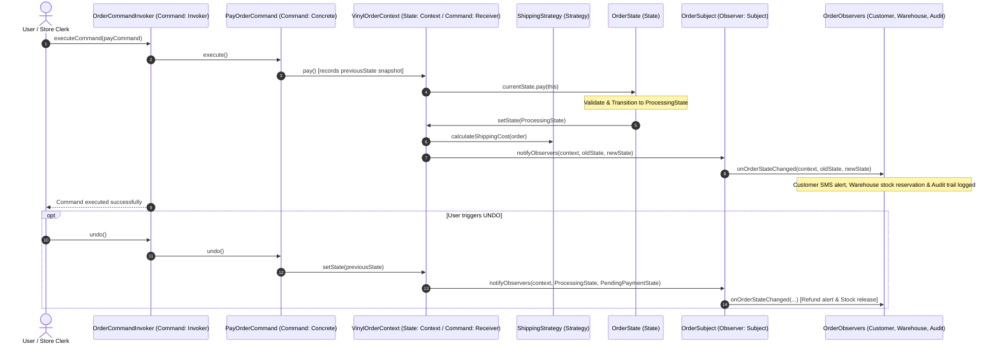
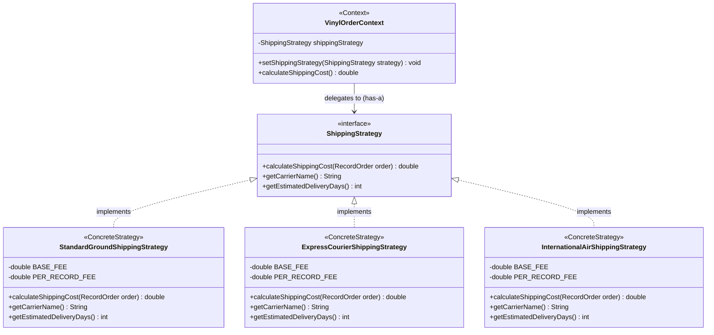
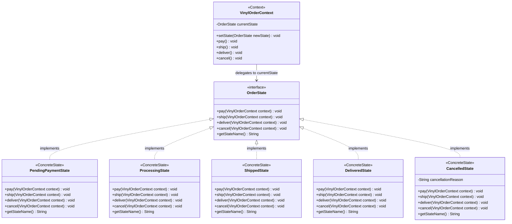
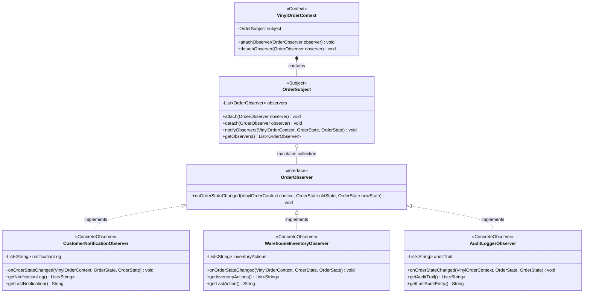
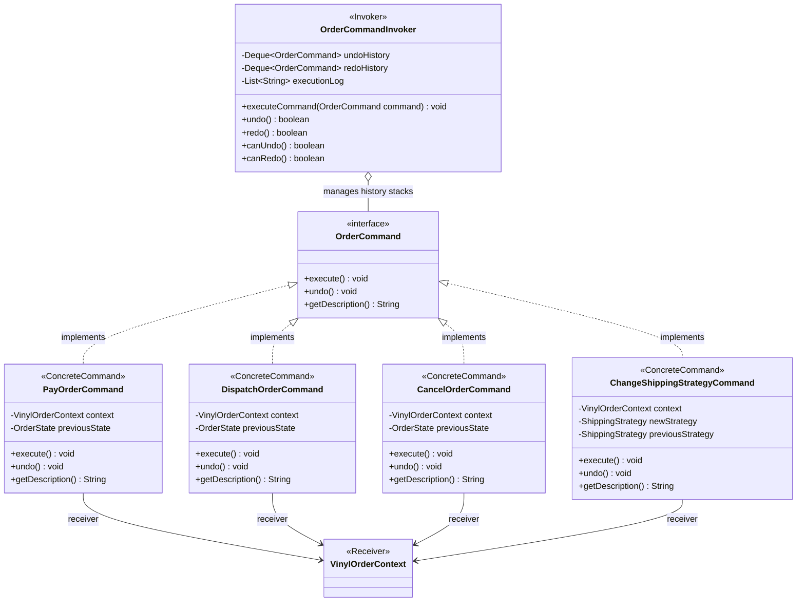

# Behavioral Design Patterns Verification Report

**Course**: Tehnici și Mecanisme de Proiectare Software (TMPS) / Software Design Techniques and Mechanisms  
**Laboratory Work**: No. 3 — Behavioral Design Patterns  
**Domain**: Vintage Groove Records (Order Lifecycle & Fulfillment System)  
**Implementation Language**: Java (OpenJDK 11+)  

---

## 1. Domain Description

**Vintage Groove Records** operates an order fulfillment platform for audiophile vinyl sales, managing the end-to-end lifecycle of record orders from checkout through courier delivery. The platform processes purchases containing multiple vinyl pressings, computes variable shipping rates across regional and international logistics carriers, enforces rigorous business state transition guards across the order's fulfillment lifecycle, broadcasts event updates to customer messaging, warehouse dispatch, and regulatory audit subsystems, and encapsulates transactional actions into reversible, queueable command objects with full undo/redo capabilities.

---

## 2. Architectural Pattern Interactions Overview

The laboratory guidelines mandate that behavioral patterns must not reside in isolated silos; at least one execution path must pass through multiple behavioral patterns. In this project, the patterns cooperate seamlessly to execute transactional workflows:



**Execution Path Flow**:
1. The **User** dispatches operations through [`OrderCommandInvoker`](file:///home/calin/code/tmps-labs/lab-3/src/com/tmps/lab3/command/OrderCommandInvoker.java#L9-L61) (Invoker).
2. The concrete command (e.g., [`PayOrderCommand`](file:///home/calin/code/tmps-labs/lab-3/src/com/tmps/lab3/command/PayOrderCommand.java#L6-L39), [`DispatchOrderCommand`](file:///home/calin/code/tmps-labs/lab-3/src/com/tmps/lab3/command/DispatchOrderCommand.java#L6-L39), [`ChangeShippingStrategyCommand`](file:///home/calin/code/tmps-labs/lab-3/src/com/tmps/lab3/command/ChangeShippingStrategyCommand.java#L6-L39)) captures a snapshot of current state and invokes the receiver [`VinylOrderContext`](file:///home/calin/code/tmps-labs/lab-3/src/com/tmps/lab3/state/VinylOrderContext.java#L9-L78).
3. The Context delegates lifecycle actions to its current polymorphic [`OrderState`](file:///home/calin/code/tmps-labs/lab-3/src/com/tmps/lab3/state/OrderState.java#L3-L9) ([`PendingPaymentState`](file:///home/calin/code/tmps-labs/lab-3/src/com/tmps/lab3/state/PendingPaymentState.java#L3-L36), [`ProcessingState`](file:///home/calin/code/tmps-labs/lab-3/src/com/tmps/lab3/state/ProcessingState.java#L3-L36), [`ShippedState`](file:///home/calin/code/tmps-labs/lab-3/src/com/tmps/lab3/state/ShippedState.java#L3-L36), [`DeliveredState`](file:///home/calin/code/tmps-labs/lab-3/src/com/tmps/lab3/state/DeliveredState.java#L3-L36), or [`CancelledState`](file:///home/calin/code/tmps-labs/lab-3/src/com/tmps/lab3/state/CancelledState.java#L3-L45)).
4. The State validates business guards (rejecting illegal transitions such as shipping an unpaid order) and transitions the Context to the target state via `context.setState(...)`.
5. Simultaneously, delivery charges are dynamically resolved via the swappable [`ShippingStrategy`](file:///home/calin/code/tmps-labs/lab-3/src/com/tmps/lab3/strategy/ShippingStrategy.java#L5-L9).
6. The state transition triggers the Context's [`OrderSubject`](file:///home/calin/code/tmps-labs/lab-3/src/com/tmps/lab3/observer/OrderSubject.java#L10-L37), which broadcasts updates to all active [`OrderObserver`](file:///home/calin/code/tmps-labs/lab-3/src/com/tmps/lab3/observer/OrderObserver.java#L6-L8) listeners: notifying the customer ([`CustomerNotificationObserver`](file:///home/calin/code/tmps-labs/lab-3/src/com/tmps/lab3/observer/CustomerNotificationObserver.java#L9-L29)), reserving/restocking warehouse inventory ([`WarehouseInventoryObserver`](file:///home/calin/code/tmps-labs/lab-3/src/com/tmps/lab3/observer/WarehouseInventoryObserver.java#L9-L43)), and recording an append-only compliance trail ([`AuditLoggerObserver`](file:///home/calin/code/tmps-labs/lab-3/src/com/tmps/lab3/observer/AuditLoggerObserver.java#L11-L32)).
7. When `invoker.undo()` is triggered, the command restores the previous state, which in turn broadcasts a reverse state-change notification to all observers.

---

## 3. Reused Creational Pattern (from Laboratory 1 & 2)

In accordance with **Requirement 5**, the project reuses the **Builder Pattern** from previous laboratories:
- **Class**: [`RecordOrderBuilder`](file:///home/calin/code/tmps-labs/lab-3/src/com/tmps/lab3/domain/RecordOrderBuilder.java#L7-L51)
- **Role**: Fluidly constructs immutable [`RecordOrder`](file:///home/calin/code/tmps-labs/lab-3/src/com/tmps/lab3/domain/RecordOrder.java#L7-L38) aggregates containing lists of [`VinylRecord`](file:///home/calin/code/tmps-labs/lab-3/src/com/tmps/lab3/domain/VinylRecord.java#L3-L28) items, managing customer identity, delivery destination, and sequential order identifier generation.

---

## 4. Behavioral Design Patterns Breakdown

To ensure clarity and maintainability, each pattern is documented with a focused, dedicated Mermaid UML class diagram rather than one gigantic monolithic diagram.

---

### 4.1. Pattern 1: Strategy Pattern

#### Intent & Problem Solved
Fulfillment logistics depend on customer urgency, transit distance, and parcel fragility. Standard domestic ground transport, next-day courier delivery, and international air shipping use fundamentally different tariff calculations and carrier logistics.

Hardcoding conditional `if/else` or `switch` statements inside the order class violates the Open/Closed Principle (OCP) and Single Responsibility Principle (SRP). Adding a new carrier would require modifying existing checkout logic. The **Strategy Pattern** abstracts shipping fee calculations behind the common [`ShippingStrategy`](file:///home/calin/code/tmps-labs/lab-3/src/com/tmps/lab3/strategy/ShippingStrategy.java#L5-L9) interface, allowing algorithms to be swapped at runtime based on user selection.

#### Dedicated UML Class Diagram



#### Code Snippet
From [`ExpressCourierShippingStrategy.java`](file:///home/calin/code/tmps-labs/lab-3/src/com/tmps/lab3/strategy/ExpressCourierShippingStrategy.java#L9-L23):

```java
    @Override
    public double calculateShippingCost(RecordOrder order) {
        if (order == null) return BASE_FEE;
        return BASE_FEE + (order.getItemCount() * PER_RECORD_FEE);
    }

    @Override
    public String getCarrierName() {
        return "Sonic Courier Express";
    }

    @Override
    public int getEstimatedDeliveryDays() {
        return 1;
    }
```
*Why this makes the pattern work*: The class encapsulates the express courier pricing algorithm behind the `ShippingStrategy` interface. The context delegates directly to `calculateShippingCost(order)` without caring which concrete strategy is currently active.

#### Unit Test Verification

| Test Method Name | Key Property Checked | Status |
| :--- | :--- | :---: |
| `testEachStrategyProducesExpectedResult()` | Proves that Ground, Express, and Air strategies compute their expected mathematical shipping costs and return their respective delivery schedules based on order volume. | **PASS** |
| `testStrategiesCanBeSwappedAtRuntime()` | Proves that changing the strategy on `VinylOrderContext` dynamically updates total order calculation and carrier metadata at runtime without modifying the context. | **PASS** |

**Execution Log**:
```text
>> Running Test Suite: StrategyPatternTest
   [PASS] testEachStrategyProducesExpectedResult                            (11 ms)
   [PASS] testStrategiesCanBeSwappedAtRuntime                               (2 ms)
```

---

### 4.2. Pattern 2: State Pattern

#### Intent & Problem Solved
A vinyl order transitions through distinct stages: `PENDING_PAYMENT`, `PROCESSING`, `SHIPPED`, `DELIVERED`, and `CANCELLED`. In each stage, the order behaves differently:
- An unpaid order cannot be shipped or delivered.
- An order in processing can be dispatched or cancelled (issuing a refund).
- An order already in transit with a carrier cannot be cancelled directly.
- Delivered or cancelled orders reject all further mutations.

Representing this lifecycle with a switch-case on an enum inside `VinylOrderContext` leads to code bloat and scattered state-transition logic. The **State Pattern** encapsulates each state in a dedicated class implementing [`OrderState`](file:///home/calin/code/tmps-labs/lab-3/src/com/tmps/lab3/state/OrderState.java#L3-L9), guaranteeing valid transitions and throwing descriptive `IllegalStateException`s for illegal actions.

#### Dedicated UML Class Diagram



#### Code Snippet
From [`PendingPaymentState.java`](file:///home/calin/code/tmps-labs/lab-3/src/com/tmps/lab3/state/PendingPaymentState.java#L5-L25):

```java
    @Override
    public void pay(VinylOrderContext context) {
        // Valid transition: Pending -> Processing
        context.setState(new ProcessingState());
    }

    @Override
    public void ship(VinylOrderContext context) {
        throw new IllegalStateException("Invalid State Transition: Cannot ship an order in PENDING_PAYMENT state. Payment must be processed first.");
    }

    @Override
    public void deliver(VinylOrderContext context) {
        throw new IllegalStateException("Invalid State Transition: Cannot deliver an unpaid order.");
    }

    @Override
    public void cancel(VinylOrderContext context) {
        // Valid transition: Pending -> Cancelled
        context.setState(new CancelledState("Order cancelled by customer before payment."));
    }
```
*Why this makes the pattern work*: The state itself controls transitions to next states (`ProcessingState`, `CancelledState`) and enforces strict domain invariants by throwing exceptions for invalid actions (`ship`, `deliver`), removing conditional branching from the context.

#### Unit Test Verification

| Test Method Name | Key Property Checked | Status |
| :--- | :--- | :---: |
| `testStateAllowsValidSequentialTransitions()` | Proves that an order successfully advances through the sequential lifecycle: `PENDING_PAYMENT` $\rightarrow$ `pay()` $\rightarrow$ `PROCESSING` $\rightarrow$ `ship()` $\rightarrow$ `SHIPPED` $\rightarrow$ `deliver()` $\rightarrow$ `DELIVERED`. | **PASS** |
| `testStateRejectsForbiddenTransitions()` | Proves that attempting illegal actions (shipping/delivering an unpaid order, duplicate payment, or cancelling an order in transit) throws `IllegalStateException`. | **PASS** |

**Execution Log**:
```text
>> Running Test Suite: StatePatternTest
   [PASS] testStateAllowsValidSequentialTransitions                         (1 ms)
   [PASS] testStateRejectsForbiddenTransitions                              (0 ms)
```

---

### 4.3. Pattern 3: Observer Pattern

#### Intent & Problem Solved
When an order transitions state (e.g. payment received, courier dispatched, or shipment cancelled), several independent downstream systems must react:
- The customer needs email/SMS dispatch notifications.
- The warehouse inventory system must reserve physical vinyl pressings or restock them upon cancellation.
- The financial audit logging system must maintain an append-only timeline of transitions.

Hardcoding references to these subsystems inside `VinylOrderContext` would create tight coupling and prevent adding or removing listeners at runtime. The **Observer Pattern** defines a one-to-many dependency using [`OrderSubject`](file:///home/calin/code/tmps-labs/lab-3/src/com/tmps/lab3/observer/OrderSubject.java#L10-L37) and [`OrderObserver`](file:///home/calin/code/tmps-labs/lab-3/src/com/tmps/lab3/observer/OrderObserver.java#L6-L8), enabling observers to attach and detach dynamically at runtime.

#### Dedicated UML Class Diagram



#### Code Snippet
From [`OrderSubject.java`](file:///home/calin/code/tmps-labs/lab-3/src/com/tmps/lab3/observer/OrderSubject.java#L13-L32):

```java
    public void attach(OrderObserver observer) {
        if (observer == null) {
            throw new IllegalArgumentException("Observer cannot be null");
        }
        if (!observers.contains(observer)) {
            observers.add(observer);
        }
    }

    public void detach(OrderObserver observer) {
        observers.remove(observer);
    }

    public void notifyObservers(VinylOrderContext context, OrderState oldState, OrderState newState) {
        // Defensive copy to prevent concurrent modification during notification
        List<OrderObserver> snapshot = new ArrayList<>(observers);
        for (OrderObserver observer : snapshot) {
            observer.onOrderStateChanged(context, oldState, newState);
        }
    }
```
*Why this makes the pattern work*: The subject maintains a collection of abstract `OrderObserver` listeners without knowledge of concrete observer types. On state change, it iterates over a defensive snapshot, cleanly broadcasting updates without re-entrancy bugs.

#### Unit Test Verification

| Test Method Name | Key Property Checked | Status |
| :--- | :--- | :---: |
| `testAllSubscribedObserversAreNotifiedOfStateChanges()` | Proves that all attached observers (Customer, Warehouse, Audit) receive notifications on state changes with correct contextual data (old state, new state, customer name, allocated items). | **PASS** |
| `testUnsubscribedObserversDoNotReceiveFurtherNotifications()` | Proves that when an observer calls `context.detachObserver(...)` at runtime, it ceases receiving notifications while remaining active observers continue receiving events. | **PASS** |

**Execution Log**:
```text
>> Running Test Suite: ObserverPatternTest
   [PASS] testAllSubscribedObserversAreNotifiedOfStateChanges               (48 ms)
   [PASS] testUnsubscribedObserversDoNotReceiveFurtherNotifications         (0 ms)
```

---

### 4.3. Pattern 4: Command Pattern

#### Intent & Problem Solved
Order fulfillment involves transactional operations: paying an order, updating delivery methods, dispatching couriers, and cancellations. Store managers need to inspect the historical log of executed operations and execute **undo** (e.g. rolling back a premature payment or reverting a shipping carrier change) or **redo**.

If invocations were executed as direct method calls without command encapsulation, there would be no clean way to track operation history, store previous parameter snapshots for rollback, or decouple the user interface from business execution. The **Command Pattern** turns each request into an [`OrderCommand`](file:///home/calin/code/tmps-labs/lab-3/src/com/tmps/lab3/command/OrderCommand.java#L3-L7) object. Business logic remains strictly inside the receiver ([`VinylOrderContext`](file:///home/calin/code/tmps-labs/lab-3/src/com/tmps/lab3/state/VinylOrderContext.java#L9-L78)), while [`OrderCommandInvoker`](file:///home/calin/code/tmps-labs/lab-3/src/com/tmps/lab3/command/OrderCommandInvoker.java#L9-L61) manages undo and redo stacks.

#### Dedicated UML Class Diagram



#### Code Snippet
From [`OrderCommandInvoker.java`](file:///home/calin/code/tmps-labs/lab-3/src/com/tmps/lab3/command/OrderCommandInvoker.java#L14-L44):

```java
    public void executeCommand(OrderCommand command) {
        if (command == null) {
            throw new IllegalArgumentException("Command cannot be null");
        }
        command.execute();
        undoHistory.push(command);
        redoHistory.clear();
        executionLog.add("EXECUTED: " + command.getDescription());
    }

    public boolean undo() {
        if (undoHistory.isEmpty()) {
            return false;
        }
        OrderCommand command = undoHistory.pop();
        command.undo();
        redoHistory.push(command);
        executionLog.add("UNDONE: " + command.getDescription());
        return true;
    }

    public boolean redo() {
        if (redoHistory.isEmpty()) {
            return false;
        }
        OrderCommand command = redoHistory.pop();
        command.execute();
        undoHistory.push(command);
        executionLog.add("REDONE: " + command.getDescription());
        return true;
    }
```
*Why this makes the pattern work*: The invoker manages execution and dual history stacks (`undoHistory`, `redoHistory`). When `undo()` is called, it pops the last command, invokes `undo()`, and moves it to the redo stack, cleanly reversing receiver state without containing business logic.

#### Unit Test Verification

| Test Method Name | Key Property Checked | Status |
| :--- | :--- | :---: |
| `testExecutingCommandAndUndoingItRestoresOriginalState()` | Proves that executing `PayOrderCommand` advances state to `PROCESSING`, and triggering `invoker.undo()` completely restores the state back to `PENDING_PAYMENT`. | **PASS** |
| `testCommandRedoAndHistoryTracking()` | Proves that multi-command execution histories are accurately tracked, that undoing and redoing commands restores target state (`SHIPPED`), and that execution audit logs match expected sequences. | **PASS** |

**Execution Log**:
```text
>> Running Test Suite: CommandPatternTest
   [PASS] testExecutingCommandAndUndoingItRestoresOriginalState             (1 ms)
   [PASS] testCommandRedoAndHistoryTracking                                 (1 ms)
```

---

## 5. Complete Unit Test Suite Results

The entire behavioral pattern test suite runs with a single command via `./test.sh` (or `java com.tmps.lab3.test.TestRunner`). Below is the full execution output:

```text
================================================================================
          TMPS Laboratory 3 Unit Test Suite (Behavioral Patterns)
================================================================================

>> Running Test Suite: StrategyPatternTest
   [PASS] testEachStrategyProducesExpectedResult                            (11 ms)
   [PASS] testStrategiesCanBeSwappedAtRuntime                               (2 ms)

>> Running Test Suite: StatePatternTest
   [PASS] testStateAllowsValidSequentialTransitions                         (1 ms)
   [PASS] testStateRejectsForbiddenTransitions                              (0 ms)

>> Running Test Suite: ObserverPatternTest
   [PASS] testAllSubscribedObserversAreNotifiedOfStateChanges               (48 ms)
   [PASS] testUnsubscribedObserversDoNotReceiveFurtherNotifications         (0 ms)

>> Running Test Suite: CommandPatternTest
   [PASS] testExecutingCommandAndUndoingItRestoresOriginalState             (1 ms)
   [PASS] testCommandRedoAndHistoryTracking                                 (1 ms)

================================================================================
Test Execution Summary: Total: 8 | Passed: 8 | Failed: 0 | Time: 119 ms
================================================================================
ALL TESTS PASSED SUCCESSFULLY! (Behavioral pattern invariants verified)
```

---

## 6. Conclusions

### What Was Harder Than Expected
1. **Coordinating Undo Operations with Observer Notifications**: When an `OrderCommand` is undone, restoring the previous state must re-trigger observers (e.g. telling the warehouse to release reserved inventory and alerting the customer of payment reversal) without producing circular notification loops. Designing the snapshot mechanism within the commands and maintaining clean unidirectional updates resolved this challenge.
2. **Encapsulating State Transitions Exclusively in State Classes**: Ensuring that `VinylOrderContext` contains no conditional switch statements required having the concrete states invoke `context.setState(...)` directly, turning `OrderState` into a true state machine where states own the transition logic.
3. **Decoupling Commands from Receiver Business Logic**: Resisting the temptation to place pricing or state transition rules inside commands ensured that commands act purely as command messengers and snapshot custodians, keeping domain rules inside the receiver.

### What Would Be Designed Differently in a Production Environment
- **Persistent Command Sourcing**: In an enterprise e-commerce platform, commands and state transitions would be persisted as immutable event streams (Event Sourcing / CQRS with Kafka or EventStore), enabling recovery from node failures.
- **Transactional Consistency with Distributed Observers**: In a distributed microservice setup, observers would be decoupled via transactional message brokers (outbox pattern) rather than synchronous in-memory listener dispatch, ensuring at-least-once delivery semantics for courier integrations.
